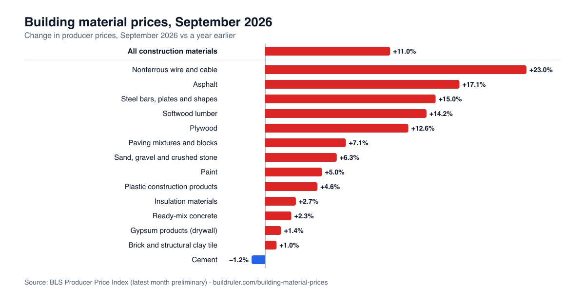

# U.S. building material prices, monthly since 1996

Producer price indexes for 14 building materials plus the all-construction-materials index, from the U.S. Bureau of
Labor Statistics, in one tidy CSV. Updated monthly after BLS publishes the Producer Price Index.

Charts, 12-month changes and what they mean for a home project: **[Building material prices by BuildRuler](https://buildruler.com/building-material-prices/)**

## The file

`data/building-material-prices.csv`, one row per month and material:

| Column | Meaning |
|---|---|
| `month` | `YYYY-MM` |
| `series_id` | BLS PPI series ID (look it up at `https://data.bls.gov/timeseries/<series_id>`) |
| `material` | Plain-English name |
| `ppi_index` | Index value, not seasonally adjusted. The base period differs by series, so compare **% changes**, not levels across materials. |
| `preliminary` | `true` for the latest four months, which BLS revises later |

| Series | Material |
|---|---|
| WPUSI012011 | All construction materials (BLS special index) |
| WPU1333 | Ready-mix concrete |
| WPU1322 | Cement |
| WPU1321 | Sand, gravel and crushed stone |
| WPU1394 | Paving mixtures and blocks |
| WPU058102 | Asphalt (no BLS data for most of 1997 to mid-2002) |
| WPU0811 | Softwood lumber |
| WPU083 | Plywood |
| WPU137 | Gypsum products (drywall) |
| WPU1342 | Brick and structural clay tile |
| WPU1392 | Insulation materials |
| WPU0621 | Paint |
| WPU101704 | Steel bars, plates and shapes |
| WPU1026 | Nonferrous wire and cable |
| WPU0721 | Plastic construction products |

These are producer (wholesale) prices. Retail prices follow with a lag and not one-for-one.

## Source and license

Data: U.S. Bureau of Labor Statistics, Producer Price Index, via the BLS public API. BLS data is in the public domain.
This compilation and the chart are released under [CC BY 4.0](https://creativecommons.org/licenses/by/4.0/).

**Please cite:** BuildRuler, "Building material prices", https://buildruler.com/building-material-prices/ (BLS Producer
Price Index data).

## Calculators

Estimating a project? BuildRuler has free calculators for the materials above, including
[concrete](https://buildruler.com/concrete-calculator/), [gravel](https://buildruler.com/gravel-calculator/),
[lumber](https://buildruler.com/lumber-calculator/), [asphalt](https://buildruler.com/asphalt-calculator/) and
[brick](https://buildruler.com/brick-calculator/).
